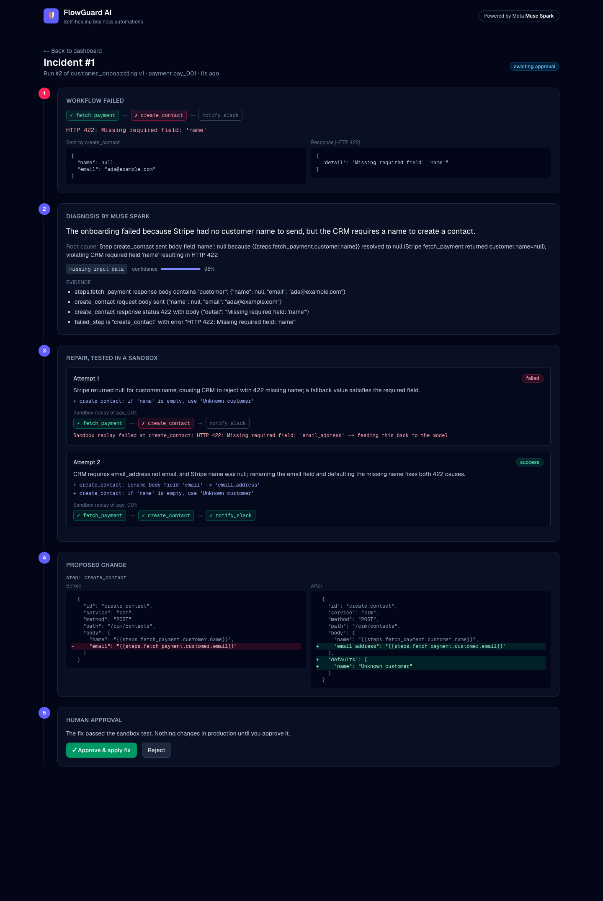
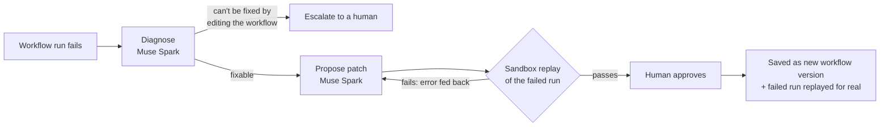
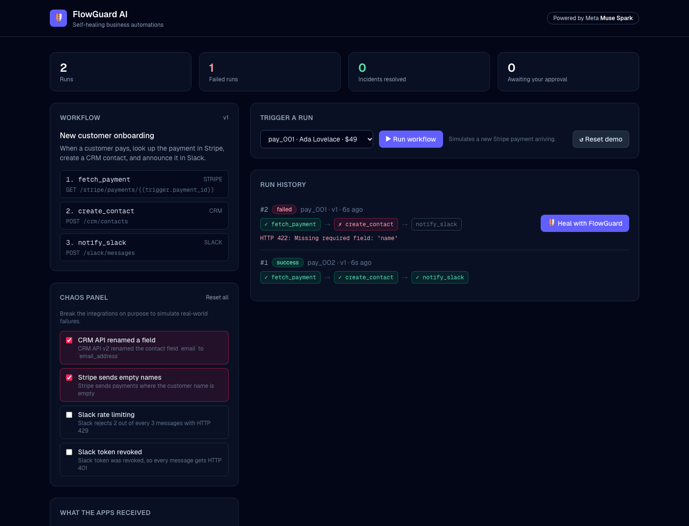
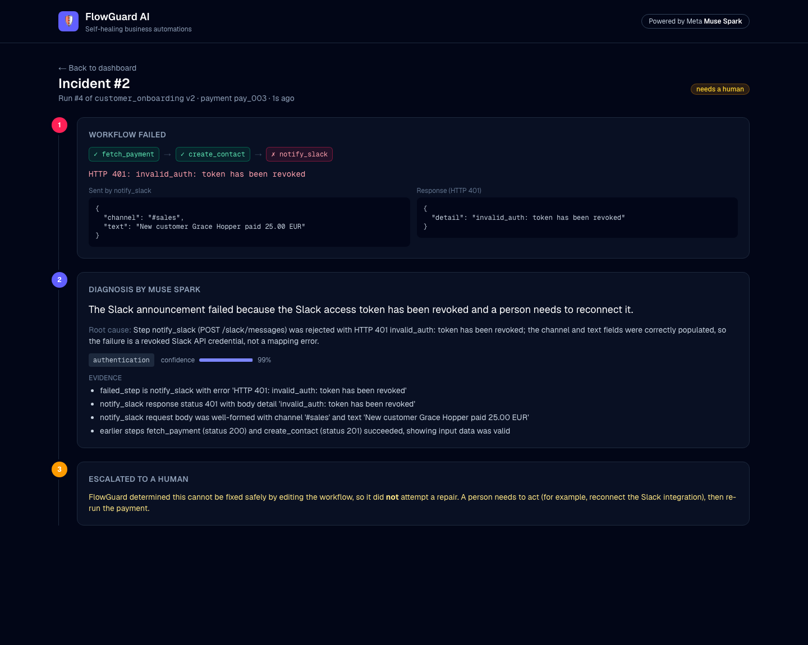

# 🛡️ FlowGuard AI: self-healing business automations

**FlowGuard watches your business workflows. When one breaks, Meta's Muse Spark diagnoses the root cause, proposes a fix, proves the fix works by replaying the failed run in a sandbox, and only then asks a human to approve it.**

Built for the [Meta Global AI Developer Hackathon](https://cerebralvalley.ai/e/meta-ai-developer-hackathon) (Indie track · *Push the Frontier*).



---

## The problem

Companies run on automations that chain apps together: *"when a customer pays in Stripe → create a CRM contact → announce it in Slack."* These chains break silently and often:

- a vendor renames a field in their API (`email` → `email_address`)
- upstream data arrives incomplete (a payment with no customer name)
- a service throttles requests (HTTP 429) or a token is revoked (HTTP 401)

Each break means lost customers or missed notifications until an engineer digs through logs, works out what changed, edits the workflow and re-runs the failed jobs. FlowGuard automates that loop **without giving up human control**.

## How it works



1. **Diagnose.** Muse Spark reads the workflow definition and the full run record (what each step sent and received). It returns a structured diagnosis: plain-English summary, root cause, category, evidence and confidence, plus whether a workflow edit can fix it. It is never told what broke.
2. **Repair.** Muse Spark proposes a patch using only **three safe operations**: `rename_field`, `set_default`, `add_retry`. It cannot delete steps, call new URLs or run code.
3. **Validate.** The patch is applied to a copy of the workflow, and the exact failed trigger is replayed in **sandbox mode**: services validate requests as normal but nothing is written. If the replay fails, the new error goes back to the model for another try (up to 3 attempts).
4. **Approve.** Nothing touches the live workflow until a human clicks **Approve**. The fix is saved as a new, audited version, and the failed run is replayed for real, so the missed customer is recovered.
5. **Escalate.** Problems a workflow edit can't fix, like a revoked token, go straight to a human with the diagnosis attached.

### Example: two failures at once (real Muse Spark output)

| | |
|---|---|
| **Failure** | `create_contact` → `HTTP 422: Missing required field: 'name'` |
| **Attempt 1** | *"if `name` is empty, use 'Unknown customer'"* → sandbox **failed**: `Missing required field: 'email_address'` |
| **Attempt 2** | *rename `email` → `email_address`* **and** keep the name fallback → sandbox **passed** |
| **Approve** | Saved as workflow v2 · payment replayed · customer recovered in the CRM |

## Results

End-to-end evaluation with the real model ([`backend/eval.py`](backend/eval.py), raw output in [`backend/eval_results.json`](backend/eval_results.json)). Each of the 4 failure types runs on 3 different payments, plus 3 cases with **two failures at once**: 15 cases in total. The model is never told what broke. A fix only counts if the patched workflow also succeeds in a **separate live run** after the sandbox test.

| Metric | Result |
|---|---|
| Fixable failures healed | **12 / 12** |
| Unfixable failures correctly escalated to a human | **3 / 3** |
| Diagnosis category accuracy | **100%** |
| Fixed on the first attempt | 75% (all 9 single failures; every double failure needed the sandbox feedback loop, and all were healed on attempt 2) |
| Average time per incident | 7.7 s |
| Average Muse Spark cost per incident | **≈ $0.01** (whole 15-case run: $0.15) |

*Caveat: this is a small benchmark built from our own failure scenarios against mock services. It shows the loop works reliably, not that it generalizes to every real-world integration.*

## Using Meta's models

| Where | Model | How |
|---|---|---|
| Diagnosis | `muse-spark-1.3` | Chat Completions + **structured output** (`response_format: json_schema`, strict) |
| Repair | `muse-spark-1.3` | Structured output with an `anyOf` schema of the three allowed operations; multi-turn feedback loop from sandbox results |

Structured output is what makes this safe enough to automate. Decoding is constrained to the schema, so every diagnosis and patch is machine-readable and can be validated before anything runs. All model calls go through one file, [`backend/llm.py`](backend/llm.py), which also tracks tokens and cost.

## Safety by design

- **Constrained actions:** three small patch operations, each validated (`agent/patches.py`). Unknown operations, missing steps or fields, and out-of-range retries are rejected before testing.
- **Proof before proposal:** every patch is tested against the exact failed input in a sandbox that writes nothing.
- **Human in the loop:** approve or reject; nothing is applied automatically.
- **Knows its limits:** credential and permission failures are escalated, not "fixed".
- **Audit trail:** every change is a new workflow version with a note saying what changed and why.
- **Stale-fix protection:** approval is refused if the workflow changed since the fix was tested.

## Quick start

**Requirements:** Python 3.12 (via [uv](https://docs.astral.sh/uv/)), Node 20+, and a [Meta Model API](https://dev.meta.ai/docs/overview) key.

```bash
# 1. Backend
cd backend
cp .env.example .env              # then put your MODEL_API_KEY in .env
uv venv --python 3.12 && uv pip install -r requirements.txt
.venv/bin/uvicorn main:app --reload           # http://127.0.0.1:8000/docs

# 2. Dashboard (new terminal)
cd frontend
npm install
npm run dev                                    # http://localhost:3000
```

**Demo flow:** click **Run workflow** (green) → tick *CRM API renamed a field* and *Stripe sends empty names* in the Chaos panel → **Run workflow** (red) → **🛡️ Heal with FlowGuard** → read the timeline → **Approve** → back on the dashboard: workflow v2, customer recovered. **↺ Reset demo** starts over.

### Tests and evaluation

```bash
cd backend
.venv/bin/pytest -v          # 35 tests; the AI is faked, so they're free and deterministic
.venv/bin/python eval.py     # real Muse Spark evaluation (15 cases), writes eval_results.json
```

Other handy scripts: `try_engine.py <switch>`, `try_diagnose.py all`, `try_repair.py all`.

## Project structure

```
backend/
  llm.py              the only file that calls Meta's Muse API (+ token/cost tracking)
  agent/diagnose.py   diagnosis prompt + JSON schema
  agent/repair.py     propose → validate → sandbox replay → feedback loop
  agent/patches.py    the 3 allowed operations and their safety checks
  engine/runner.py    workflow engine (templated HTTP steps, defaults, retries, full run records)
  engine/workflows/   workflow definitions (JSON)
  mocks/              fake Stripe / CRM / Slack + chaos switches + sandbox mode
  db.py               SQLite: workflows, versions, runs, incidents
  main.py             FastAPI server
  eval.py             end-to-end evaluation with the real model
  tests/              pytest suite
frontend/             Next.js 16 + Tailwind dashboard
```

## Limitations and next steps

- The services are realistic **mocks**, so failures are reproducible for the demo. Next: connectors for n8n / Zapier / Make and real APIs.
- Three patch operations cover common schema, data and throttling failures. Next: value transforms, endpoint-version upgrades and multi-step edits, each with its own validator.
- Next: auto-healing on failure (no button press), Slack approval requests, and fleet-level learning from past incidents.

## Screenshots

| Failed run on the dashboard | Escalated to a human |
|---|---|
|  |  |

---

Built by Ravi Teja N with Meta Muse Spark.
